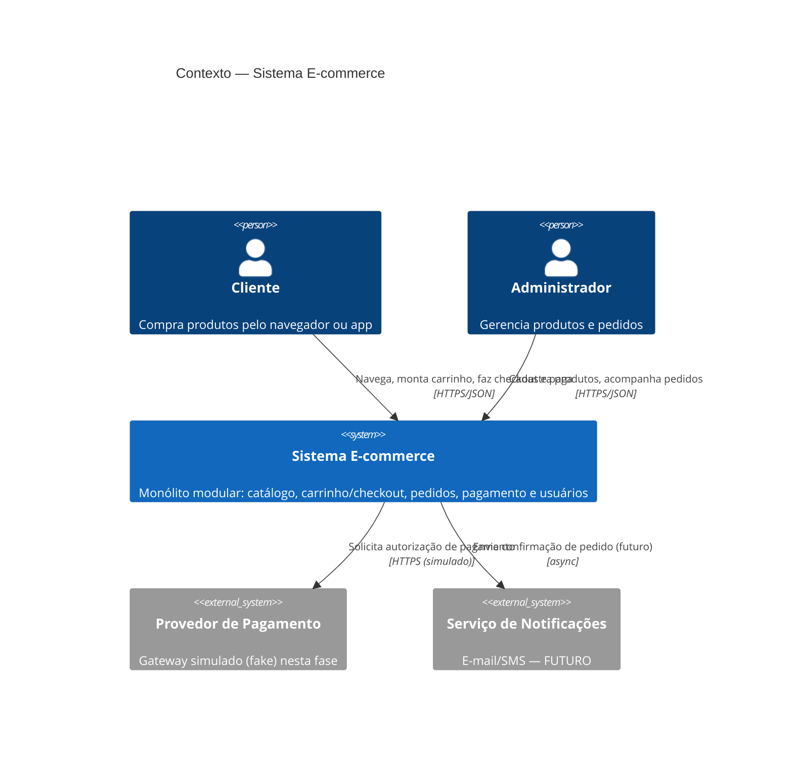

# 03 — C4 Nível 1: Contexto

Mostra o sistema como uma caixa só e quem/o que conversa com ele.

## Elementos
| Elemento | Tipo | Responsabilidade |
|----------|------|------------------|
| Cliente (web/app) | Pessoa | Consome a API REST para comprar. |
| Administrador | Pessoa | Opera a loja (rotas admin — futuro). |
| Sistema E-commerce | Sistema (nosso) | Toda a regra de negócio, num único deploy. |
| Provedor de Pagamento | Sistema externo | Aprovar/recusar pagamento. Nesta fase é um *fake* dentro do módulo `pagamento`, atrás de uma interface (porta) para trocar por um gateway real depois. |
| Notificações | Sistema externo (futuro) | Avisar o cliente sobre pedido/pagamento. |

> Versão em texto, caso o Mermaid C4 não renderize:
>
> `Cliente (web/app)  <--HTTPS/JSON-->  [ Sistema E-commerce (Monólito) ]  <--HTTPS-->  Provedor de Pagamento (simulado)`
> `                                                   |`
> `                                                   +--async (futuro)-->  Notificações`
