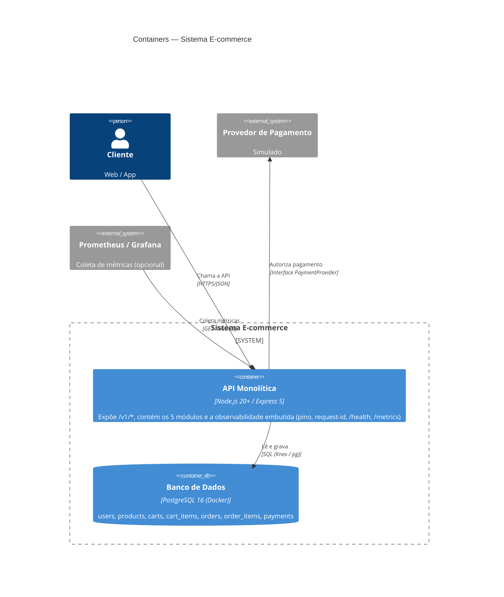

# 04 — C4 Nível 2: Containers

Abre a caixa "Sistema E-commerce" e mostra o que é implantado/executado separadamente.

## Containers
| Container | Tecnologia | Observações |
|-----------|-----------|-------------|
| **API/Backend Monolítico** | Node.js + Express 5 | Um único processo e um único deploy. Os módulos ficam em `src/modules/*`. |
| **PostgreSQL** | Postgres 16 em Docker (`docker-compose.yml`) | Migrations em `db/migrations`, seeds em `db/seeds`. |
| **Observabilidade embutida** | pino + pino-http, prom-client | Não é container separado: roda dentro da API. Logs JSON no stdout, `x-request-id`, `GET /health/live`, `GET /health/ready`, `GET /metrics`. |

> Texto: `Cliente → [API Express (módulos + pino + /metrics)] → [Postgres (Docker)]`; `API → Pagamento (simulado)`; `Prometheus → GET /metrics`.
