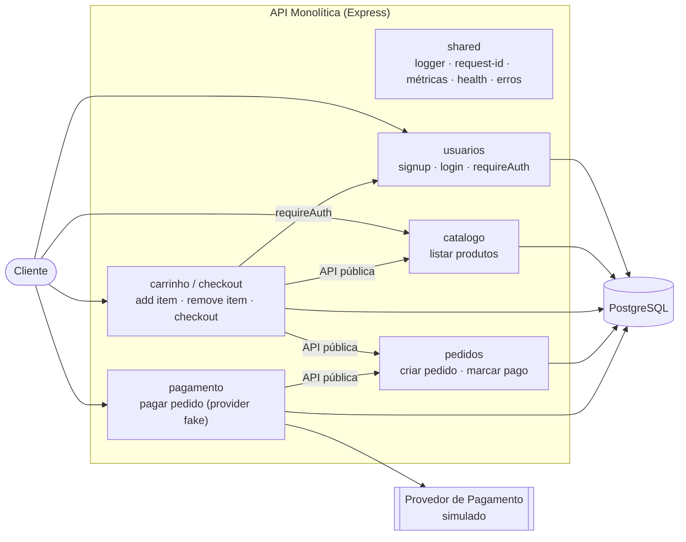
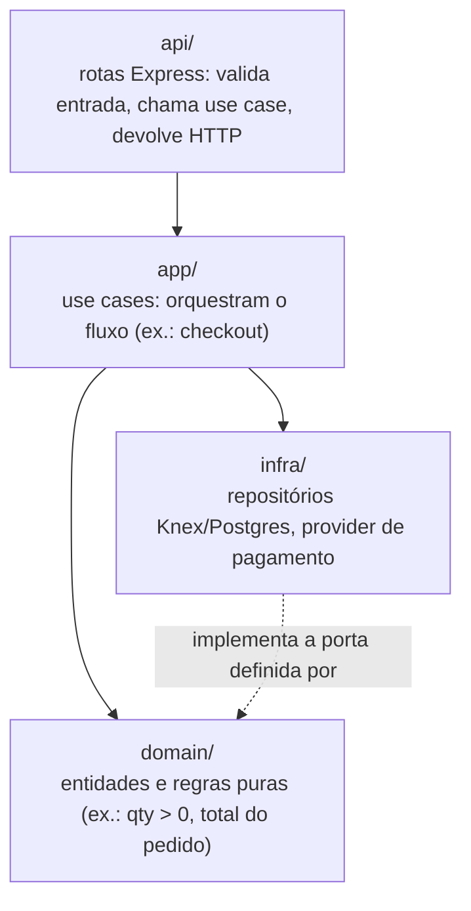

# 05 — C4 Nível 3: Componentes

Abre o container "API Monolítica" e mostra os módulos e suas camadas.

## Visão geral dos módulos



**Regra de dependência entre módulos:** um módulo só importa o `index.js` (API pública) de outro módulo. Nunca `domain/` ou `infra/` de outro módulo. Não existe dependência circular:

```
usuarios   ← carrinho, pagamento (só o middleware requireAuth)
catalogo   ← carrinho
pedidos    ← carrinho (checkout), pagamento
```

## Camadas dentro de cada módulo



| Camada | Pode depender de | Não pode |
|--------|------------------|----------|
| `api` | `app` | acessar o banco direto |
| `app` | `domain`, interfaces de repositório (injetadas) | conhecer Express (`req`/`res`) |
| `domain` | nada (JS puro) | importar Knex, Express ou outro módulo |
| `infra` | `domain`, Knex | conter regra de negócio |

## Componentes por módulo

| Módulo | api (rotas) | app (use cases) | domain | infra |
|--------|-------------|-----------------|--------|-------|
| `usuarios` | `POST /usuarios/signup`, `POST /usuarios/login` | `signup`, `login`, `verifyToken` | `User`, papéis | `userRepository`, `passwordHasher` (bcrypt) |
| `catalogo` | `GET /catalogo/produtos` | `listProducts`, `getProductsByIds` | `Product` | `productRepository` |
| `carrinho` | `POST /carrinho/items`, `DELETE /carrinho/items/:itemId`, `POST /checkout` | `addItem`, `removeItem`, `checkout` | `Cart`, `CartItem` | `cartRepository` |
| `pedidos` | — (por enquanto só API pública) | `createOrderFromCart`, `getOrder`, `markOrderPaid` | `Order`, `OrderItem`, status | `orderRepository` |
| `pagamento` | `POST /pagamentos` | `payOrder` | `Payment`, status | `paymentRepository`, `fakePaymentProvider` |

Composição: `src/app.js` cria cada módulo injetando `db` e as APIs públicas das dependências (injeção de dependência manual, sem framework).
