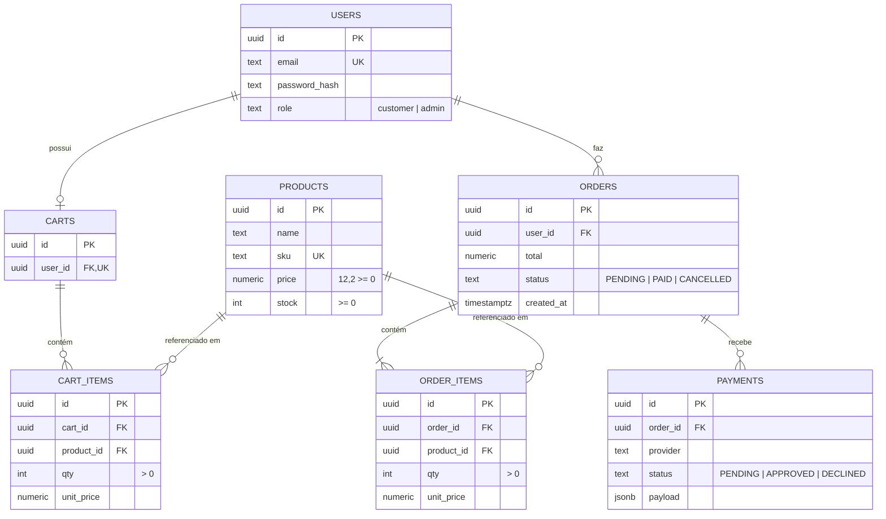

# 06 — Modelo de Dados

Tabelas mínimas para iniciar o projeto. No banco os nomes seguem `snake_case` (padrão Postgres); no código JS, `camelCase`.

## Tabelas

| Entidade (enunciado) | Tabela | Colunas | Dono (módulo) |
|---|---|---|---|
| `User(id, email, passwordHash, role)` | `users` | `id uuid PK`, `email text UNIQUE`, `password_hash text`, `role text CHECK (customer, admin)`, `created_at`, `updated_at` | usuarios |
| `Product(id, name, sku, price, stock)` | `products` | `id uuid PK`, `name text`, `sku text UNIQUE`, `price numeric(12,2) CHECK >= 0`, `stock int CHECK >= 0`, timestamps | catalogo |
| `Cart(id, userId)` | `carts` | `id uuid PK`, `user_id uuid FK users UNIQUE` (1 carrinho ativo por usuário) | carrinho |
| `CartItem(id, cartId, productId, qty, unitPrice)` | `cart_items` | `id`, `cart_id FK ON DELETE CASCADE`, `product_id FK`, `qty int CHECK > 0`, `unit_price numeric(12,2)`, `UNIQUE(cart_id, product_id)` | carrinho |
| `Order(id, userId, total, status, createdAt)` | `orders` | `id`, `user_id FK`, `total numeric(12,2)`, `status text CHECK (PENDING, PAID, CANCELLED)`, `created_at timestamptz` | pedidos |
| `OrderItem(id, orderId, productId, qty, unitPrice)` | `order_items` | `id`, `order_id FK ON DELETE CASCADE`, `product_id FK`, `qty int CHECK > 0`, `unit_price numeric(12,2)` | pedidos |
| `Payment(id, orderId, provider, status, payload)` | `payments` | `id`, `order_id FK`, `provider text`, `status text CHECK (PENDING, APPROVED, DECLINED)`, `payload jsonb`, `created_at` | pagamento |

## Decisões
- **UUID** como chave (`gen_random_uuid()`, nativo no Postgres 13+): não expõe sequência e facilita extrair módulos depois.
- **Dinheiro em `numeric(12,2)`**, nunca `float` (evita erro de arredondamento).
- **`unit_price` copiado** para `cart_items`/`order_items`: o pedido guarda o preço do momento da compra, mesmo que o produto mude depois.
- **Cada tabela tem um módulo dono**; só ele escreve nela. Outros módulos leem pela API pública do dono.
- **FKs entre módulos mantidas por enquanto** (integridade garantida pelo banco). Se um módulo for extraído, a FK vira referência por ID + validação na aplicação.
- Índices: `users.email`, `products.sku` (únicos), `orders.user_id`, `payments.order_id`.
- Migrations em `db/migrations` (uma por módulo) e dados de exemplo em `db/seeds`.
